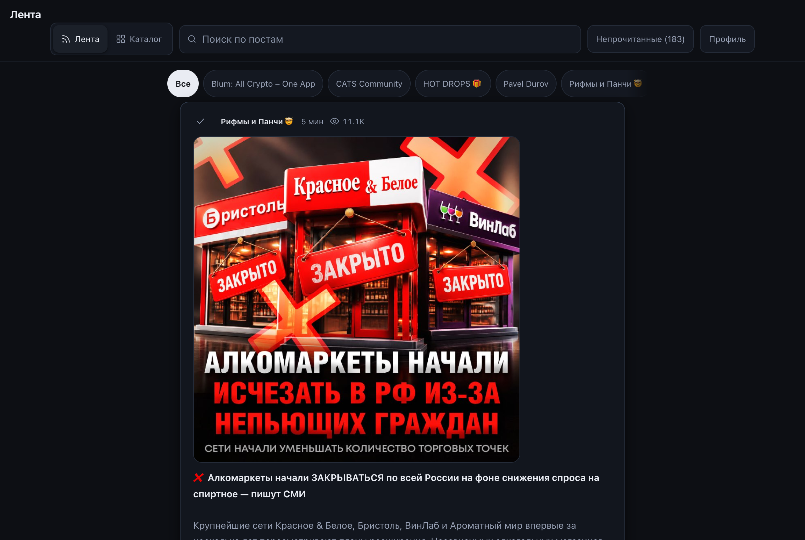
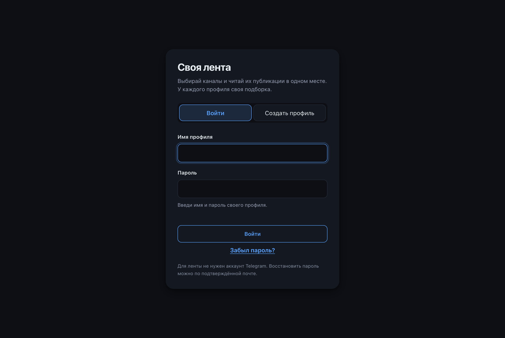
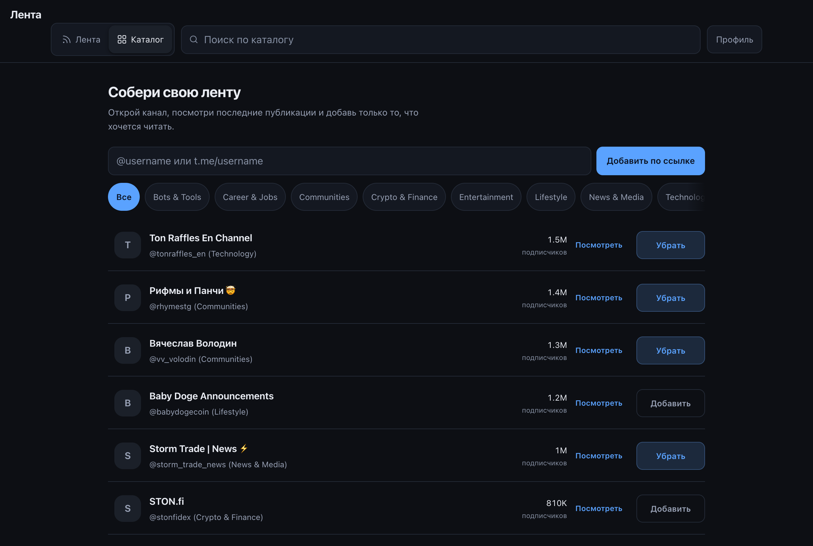
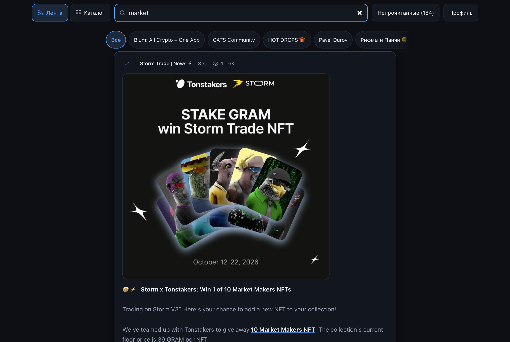
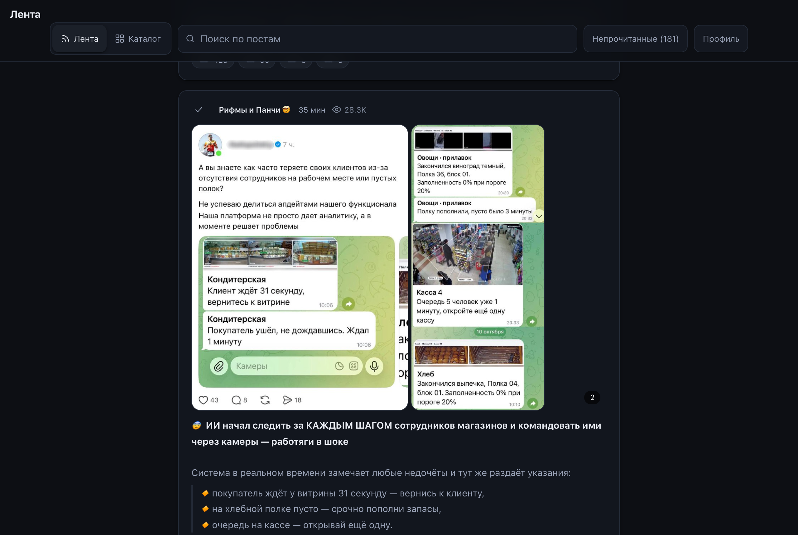
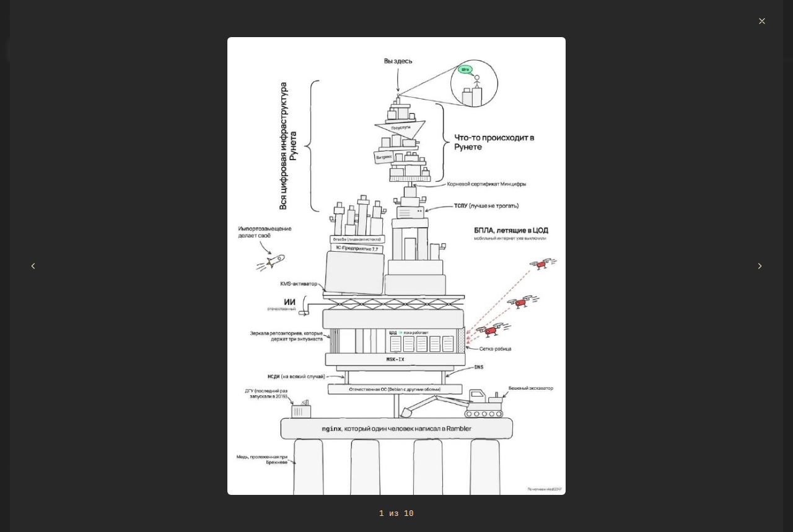
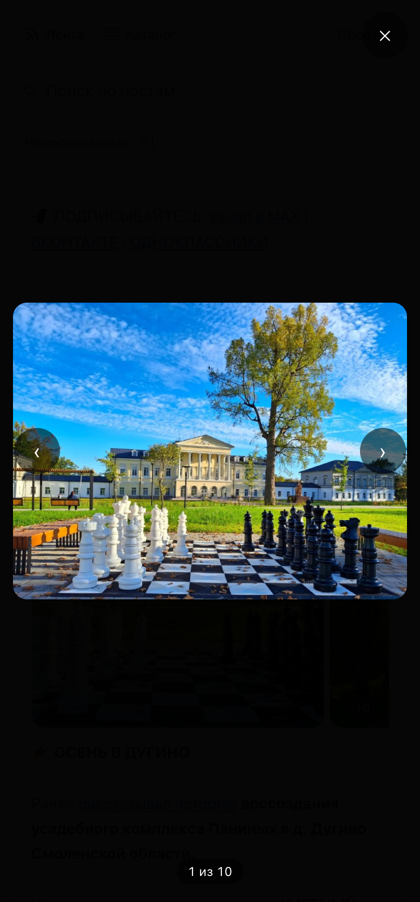
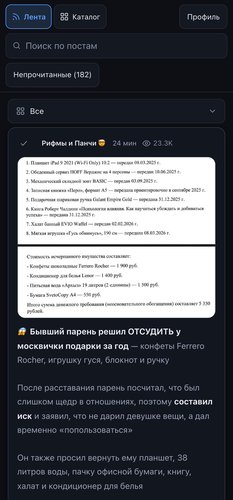
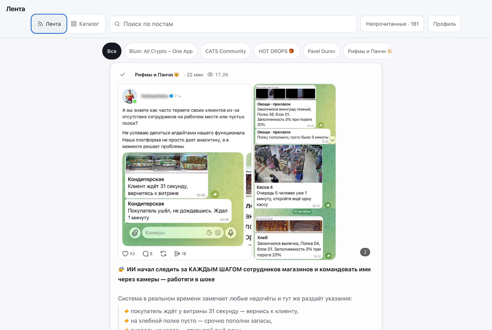
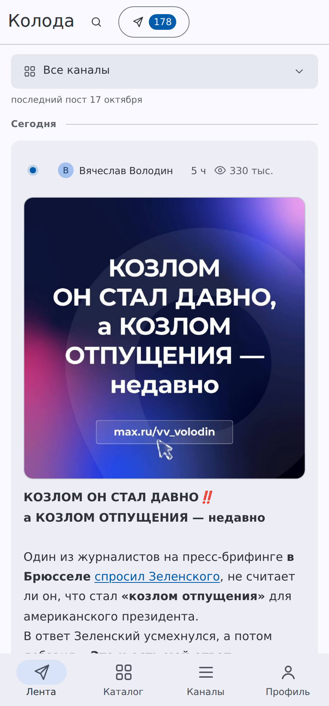

# Колода

Собирай публичные Telegram-каналы в одну ленту и читай её в своём ридере.
Аккаунт Telegram не нужен: сервис читает публичные превью-страницы.



## Быстрый старт

```bash
git clone https://github.com/aa-blinov/koloda.git && cd koloda
cp .env.example .env     # впиши данные SMTP-почты
docker compose up -d
```

Открой **http://127.0.0.1:8090**, создай профиль и зайди в **Каталог**: там видно
последние публикации каждого канала, а кнопка добавляет его в ленту.

Почта нужна для регистрации: профиль активируется после перехода по ссылке из письма.

С телефона в той же сети открой `http://<ip-компьютера>:8090`.



## Что внутри

- **Каталог**: список каналов TGMania с категориями и поиском, только для вошедшего профиля. Канал можно
  раскрыть и посмотреть публикации до того, как добавлять. Справа от поиска три сортировки:
  по подписчикам, по названию и по постам (свежесть последнего поста из ленты; каналы, от
  которых постов ещё нет, уходят в конец). Порядок задаёт клиент, потому что TGMania отдаёт
  каналы как попало, а сортировку по свежести постов считает сервер по своей базе.
- **Свой канал**: добавить по имени или ссылке `t.me/username`, доступность проверяется.
- **Лента**: посты из выбранных каналов вперемешку, по времени публикации. На странице
  80 записей, кнопка «Загрузить ещё» продолжает ту же хронологию. Каналов в ленте может
  быть до 200.
- **Непрочитанные**: пост засчитывается прочитанным, когда видна большая его часть, кликать
  не нужно. Галочка у прочитанного поста возвращает его обратно, если ты его перечитал.
  Прочитанное не показывается в ленте при следующем открытии: кнопка «Показать прочитанное»
  возвращает его. Новые посты сами ленту не меняют: обновляет её кнопка «Показать новые» или
  жест «потянуть вниз» у верха ленты. Тогда прочитанное уходит с экрана. До обновления то, что
  прочитано в этом сеансе, остаётся на месте.
  Один фильтр на все каналы, у кнопки видно, сколько непрочитанного осталось.
  Считаются посты не старше двух недель (`UNREAD_DAYS`): архив догрузки не раздувает счётчик.
- **Поиск**: по постам в ленте и по названиям в каталоге, с задержкой ввода.
- **Вкладки каналов**: быстрый переход к одному каналу.
- **Медиа**: фото и видео грузятся напрямую с CDN Telegram, сервер ничего не проксирует.
  Альбом листается свайпом, счётчик кадров в углу; кадры подгружаются по мере прокрутки,
  а не все сразу. Клик по кадру открывает его целиком, листается стрелками. Видео не
  тянется, пока не нажат play.
- **Профили**: вход по имени и паролю, у каждого профиля своя лента. Сброс пароля идёт
  по ссылке на подтверждённую почту.



Лента и каталог равноправны, переключатель стоит в шапке. Модального окна нет: выбор
каналов это основная задача, и прерывать её незачем. Выбранный раздел запоминается.







Просмотр кадра целиком на телефоне: стрелки листают, крестик в углу закрывает.





## Как читаются каналы

Посты берутся из публичной превью-страницы `t.me/s/<username>`. Telegram отдаёт её без
логина, поэтому сервису не нужны ни `api_id`, ни телефон, ни сессия Telethon.

Приватные каналы так не читаются: у них нет публичной превью-страницы. Для них нужна
авторизация по QR, она осталась в `sync.py` и `serve.py`, но текущий сервис её не
использует.

Всё складывается в SQLite (`feed.db`): посты, заголовки, профили, подписки и отметки
прочитанного. Канал обновляется не чаще раза в 5 минут, чтобы не дёргать t.me на каждый
перезапуск.

## Профили и состояние

Подписки и прочитанные публикации хранятся на сервере и привязаны к профилю. Пароль лежит
только в виде PBKDF2-отпечатка с солью. После входа браузер получает cookie сессии на
30 дней. Имя профиля видно другим посетителям сайта, но оно никак не связано с аккаунтом
Telegram.

Первый профиль в браузере может перенести прежний список каналов и отметки прочитанного в
новый аккаунт.

### Резервная копия

В профиле есть «Скачать файл» и «Загрузить файл». Файл называется `koloda-lenta.jsonl`
и содержит по записи на строку, без обёртки:

```
{"type": "channel", "channel": "durov"}
{"type": "read", "post": "durov/552"}
```

Каналы и отметки прочитанного — всё, что попадает в файл. Тема и шрифт остаются на
устройстве, на них это не влияет.

Загрузка **дополняет** текущую ленту, а не заменяет её: свой канал из файла не пропадёт,
а вложенный канал просто добавится. Если нужна именно замена, сначала убери лишние
каналы вручную и потом загрузи файл. Файл из другого профиля сработает так же: друг
может скачать свою ленту, отдать тебе файл, а ты загрузишь его себе.

Файл читается на клиенте, построчно, и уходит в уже существующий `/api/state/merge`,
где каждое имя канала и каждая отметка проходят проверку. Мусор в файле молча
отбрасывается, а не ломает страницу.

### Бэкап

База лежит в томе `feed-data` и работает в режиме WAL: рядом с `feed.db` появляются
`feed.db-wal` и `feed.db-shm`. Копировать один `feed.db` нельзя — в момент копирования
последние закоммиченные изменения могут лежать в `-wal` и в копию не попадут.

Правильный способ — снимать копию средствами SQLite, она сама делает корректный снимок:

```
docker compose exec -T feed python3 -c \
  "import sqlite3;s=sqlite3.connect('/data/feed.db');d=sqlite3.connect('/tmp/feed.db');s.backup(d);d.close();s.close()"
docker compose cp feed:/tmp/feed.db ./feed.db
docker compose exec -T feed rm /tmp/feed.db
```

Второй путь — снять том целиком: `docker run --rm -v koloda_feed-data:/data -v "$PWD":/backup
alpine tar czf /backup/koloda-$(date +%F).tgz -C /data .` Это сохраняет и файлы сессий
Telegram, но права на них после распаковки слетают: восстановленный каталог `tg` нужно
вернуть в 0700, а файлы внутри в 0600.

Проверять восстановление надо на копии, а не на живой базе: распакованный архив открыть
`sqlite3 feed.db "select count(*) from posts"` и убедиться, что число постов совпадает.

### Список для переноса

В профиле есть «Скачать список» и «Загрузить список». Список — обычный текст: одна ссылка
на канал в строке, `https://t.me/имя`. Его можно открыть в блокноте, переслать или загрузить
в другой профиль. Отметок о прочитанном в нём нет: для них есть файл ленты выше. При загрузке
принимаются ссылки `t.me/имя` и `@имя`, остальные строки пропускаются и считаются в сообщении.

### Если ставишь сайт в интернет

Регистрация открыта, любой посетитель заводит свой профиль.

Прокси ставишь сам, но две вещи в `.env` пропустить нельзя, иначе друзья не смогут
войти, а ты не заметишь почему:

```
COOKIE_SECURE=1
APP_BASE_URL=https://твой-домен
```

`COOKIE_SECURE=1` добавляет флаг Secure к куке сессии. Пока он выключен, пароль и
кука идут через интернет открытым текстом, и этого не видно ни на странице, ни в
логах. Для локального запуска по `http://127.0.0.1:8090` оставь `0`.

`APP_BASE_URL` подставляется в ссылки из писем: подтверждение почты и восстановление
пароля. Если там останется `http://127.0.0.1:8090`, письмо другу придёт со ссылкой,
которая откроется только на твоём компьютере, и пароль он не восстановит. При старте
контейнер печатает предупреждение, если почта включена, а адрес остался http.

Проверь перед тем, как звать друзей: открой сайт по публичному адресу, заведи
профиль, попроси у друга вставить присланный код на его устройстве и убедись, что
лента у него та же.

На машине, где сайт стоит за общим Caddy (`~/infra/caddy`), он живёт на
`koloda-tg.duckdns.org`. Порт на хосте не публикуется: `docker-compose.override.yml`
(файл только для этой машины, в репозиторий не входит) снимает `ports` и сажает
контейнер в общую сеть `edge` на адрес `172.40.0.50`. Поэтому `http://127.0.0.1:8090`
на этой машине не отвечает, зато домен всегда по HTTPS.

### Приватные каналы

Публичные каналы читаются как раньше, через `t.me/s/<имя>`, и вход в Telegram для них
не нужен. Приватные так не читаются: там нужен вход под аккаунтом, поэтому появляется
кнопка «Подключить Telegram» в окне профиля. После неё открывается ссылка
`tg://login?token=…`: её надо открыть в своём Telegram и подтвердить вход, потом
нажать «Я подтвердил вход». Приложение читает из аккаунта только те каналы, где
ты участник, и показывает их в общем списке ленты.

Три вещи, о которых стоит знать заранее.

**Сессия — это готовый вход в аккаунт, а не пароль.** Из файла сессии можно войти как
ты, поэтому он лежит в томе данных под правами 0600 и в базу не пишется: в бэкап
SQLite он не попадает. По той же причине «Отключить Telegram» стирает файл, а не
просто забывает его. Случайно этот файл утечёт — смени пароль от Telegram.

**Приватные посты привязаны к профилю.** Они лежат в отдельной таблице `private_posts`
с колонкой `profile`, и запрос ленты достаёт их только по профилю, который их принёс.
Класть их в общую таблицу `posts` нельзя: регистрация на сайте открыта, и тогда чужий
профиль увидел бы чужую приватную ленту, назвав её ключ.

**Медиа тянется по запросу.** Telegram не отдаёт для приватных каналов публичную ссылку
на файл. Поэтому картинка или короткое видео скачивается через MTProto, когда её открывают,
и отдаётся через `/api/tg/media` только подписчику канала. Файлы до 15 МБ, из типов
JPEG, PNG, WebP, GIF и MP4. Скачанное лежит на диске в кэше до 500 МБ. Альбом приходит
одним постом со всеми кадрами, видео перематывается (Range).

**Обновление в фоне.** Приватные каналы из ленты обновляются сами: раз в 15 минут, не чаще.
Кнопка «Обновить посты» обновляет сразу. Ошибка Telegram (нет входа, лимит запросов)
не повторяется чаще, чем раз в 10 минут. Берётся до 40 последних сообщений на канал,
глубже история не грузится.

Все обращения к Telegram одного профиля идут по одному: файл сессии не выносит двух
клиентов сразу.

Telethon стоит в образе, но импортируется лениво: пока нет профиля с подключённым
Telegram, `tg.py` не ходит в сеть вовсе. Свои `api_id`/`api_hash`, если понадобятся,
задаются переменными `TG_API_ID` и `TG_API_HASH`; по умолчанию берутся официальные
ключи Telegram Desktop, и этого хватает для входа по ссылке.

## Оформление

Интерфейс собран по Material 3: тональные поверхности вместо рамок и теней, три вида кнопок,
пилюльные поля и нижняя панель, где текущий раздел подсвечен пилюлей. Цвета, радиусы и тени
заданы токенами в `:root`, в разметке своих значений нет.

Нейтральные поверхности посчитаны по схеме Tonal Spot из Material 3 от seed `#5aa2ff`. Акцент
взят из схемы Vibrant: в Tonal Spot синий выходит серым, а ссылкам и главной кнопке нужен синий.

Радиусы лежат в шкале M3: `--r-xs` 4px, `--r-sm` 8px, `--r-md` 12px, `--r-xl` 28px (диалоги и
карточка входа), плюс `--r-pill` и `--r-round`. Остальное скругление в разметке не встречается.

Отступы идут по шкале `--sp-1` … `--sp-8`: 4, 8, 12, 16, 24, 32, 48 и 64 px. Литералов вне шкалы
в стилях нет, двухпиксельные зазоры не в счёт. Это проверяет `SpacingScaleTest`. Колонка
контента (лента, каталог, канал, профиль) одна, 748 px с полями 24 px на компьютере и 16 px
на телефоне. Шапка шире, 1120 px: в ней поиск и кнопки.

Контраст текста минимум 4.5:1 на всех подложках в обеих темах. Это проверяет `ThemeContrastTest`
в `test_app.py`: он читает токены из `index.html`. Самые тесные пары: в тёмной `--faint` 4.87:1
на `--raise`, в светлой `--faint` 4.72:1 на `--raise` и `--acc` 5.22:1 на `--raise`. Светлый
`--dim` темнее обычного, иначе он сливался бы с `--faint`.

Кнопок три вида. Главная (`.btn`) залита акцентом с текстом `--acc-ink`: 6.07:1 в тёмной и 6.04:1
в светлой. Переключатели, чипы фильтров и кнопки каталога обведены, текстовые без рамки. Выбранный
вариант (отрезок сегмента, чип, пункт списка) заливается `--sec-cont` с текстом `--on-sec-cont`:
6.07:1 в тёмной и 6.10:1 в светлой. Слой состояния по спецификации M3: 8% на наведении, 12% при
нажатии. Отключённая кнопка гаснет до 38% непрозрачности и курсор становится стрелкой.

Снэкбар отмены лежит на инверсной поверхности (`--inv-surf`) и на телефоне стоит над нижней панелью.

Тема и шрифт выбираются в профиле, сохраняются на сервере и переживают перезагрузку. Вариант «как
в системе» следит за `prefers-color-scheme`. Шрифты только системные, ничего не тянется из сети:
системный, с засечками, моноширинный и гротеск. Значения приходят из браузера, поэтому сервер
сверяет их со списком и отвечает 400 на неизвестное.





Иконки набраны инлайновым SVG в начале документа, одним штрихом и весом. Символы юникода
(`👁`, `✕`, `✓`) как иконки не используются. Выделение текста, скроллбары и фокусные кольца
переопределены явно, иначе страница выглядит собранной из готовых блоков.

## Проверки

Тесты и проверка разметки гоняются на каждом пуше в GitHub Actions: `python3 -m unittest`,
`python3 check_ui.py` и `docker build`. Последняя нужна потому, что `Dockerfile` копирует файлы
поимённо, и новый модуль без строки в `COPY` собирается, но падает при первом обращении.

Сверяет медиа в базе с тем, что отдаёт t.me прямо сейчас:

```bash
docker compose exec -T feed python3 -c "import sqlite3;s=sqlite3.connect('/data/feed.db');d=sqlite3.connect('/tmp/feed.db');s.backup(d);d.close();s.close()" && docker compose cp feed:/tmp/feed.db ./feed.db && docker compose exec -T feed rm /tmp/feed.db && python3 audit_media.py
```

Копия делается средствами SQLite внутри контейнера: база в WAL, и обычное копирование одного файла `feed.db` могло бы потерять последние записи. Скрипту нужен интернет. Он находит посты, где в базе остался эмодзи вместо фотографии, потерянные
кадры альбома и устаревшие адреса.

## Ограничения

- Только публичные каналы. Приватные через `t.me/s` не читаются.
- Превью `t.me` отдаёт около 20 последних постов за один запрос. История подписанных каналов
  догружается в фоне страницами, не больше 500 постов на канал. Дальше история только в Telegram.
- Каналы обновляются параллельно, до 8 за раз. Если один источник недоступен, остальные
  показываются с предупреждением.
- В ленте может быть не больше 200 каналов.

## Разработка

```bash
docker compose up -d --build    # пересобрать после правок кода
docker compose logs -f          # журнал
docker compose down             # остановить
```

Контейнер поднимается сам после перезагрузки (`restart: unless-stopped`). В macOS автозапуск
делает Docker Desktop или LaunchDaemon.

Логи запросов выключены, чтобы не засорять вывод. Включаются переменной:

```bash
LENTELE_LOG=1 docker compose up -d
```

### Проверки

```bash
python3 check_ui.py
python3 -m unittest -v test_app.py
```

`check_ui.py` сверяет, что все `id`, на которые ссылается скрипт, есть в разметке, что у
оверлеев есть `position:fixed` и что внешних скриптов нет. Он ловит тот класс поломок,
который не даёт ошибок в консоли: интерфейс просто молча перестаёт работать.

## Файлы

| Файл | Что делает |
|---|---|
| `app.py` | Сервер: разбор t.me, API `/api/feed` и `/api/check`, отдача интерфейса |
| `index.html` | Интерфейс, без сборки и зависимостей |
| `test_app.py` | Проверки порядка, страниц, частичных ошибок и синхронизации |
| `check_ui.py` | Сверка целостности интерфейса без браузера |
| `feed.db` | SQLite: посты, заголовки, профили, подписки, прочитанное |
| `sync.py`, `serve.py` | Вариант с авторизацией по QR, сейчас не используется |